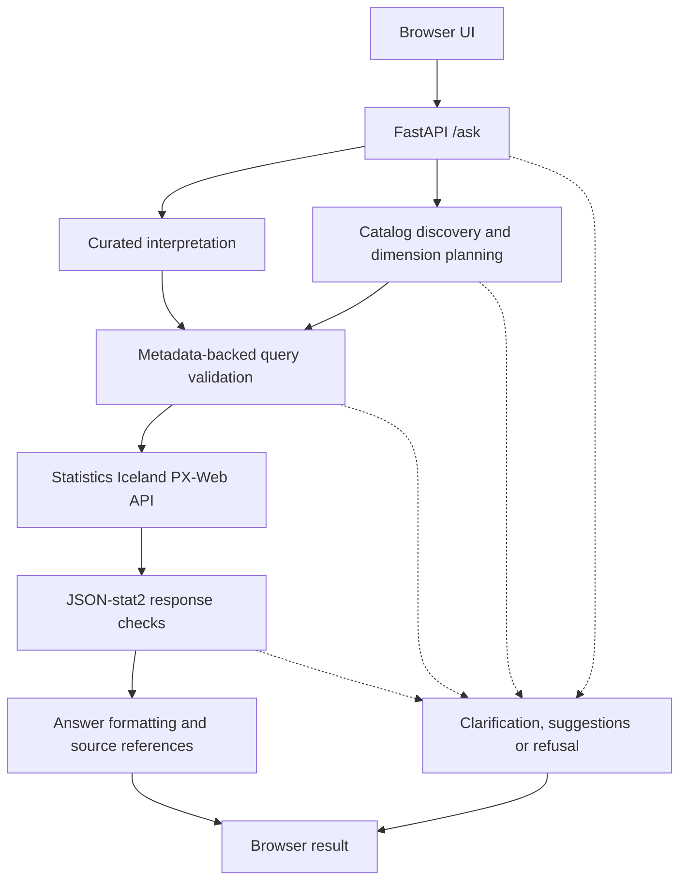

# How Talnaspor works

A study guide: the data, how a question is interpreted, how the query is built and
checked, and why the answers can be trusted.

**The mental model in one sentence:** a question becomes a filled-in form for one Statistics
Iceland table, with exactly one value chosen for every column, and only Statistics Iceland
supplies the number. Everything else in the system exists to fill that form correctly, or
to refuse when it cannot.



Table **metadata** describes dimensions, allowed categories and labels; **observations**
are the numerical cells retrieved after selection. Metadata is fetched before query
validation and also guides catalog planning; the diagram shows the main answer path.
[Curated interpretation](../src/talnaspor/interpret.py) uses configured CPI and population
tables; [catalog discovery](../src/talnaspor/catalog.py) and
[dimension planning](../src/talnaspor/planner.py) handle other questions.

[Query validation](../src/talnaspor/query.py) checks allowed selections, and
[response checks](../src/talnaspor/jsonstat.py) verify that returned cells match the query.
Neither proves that the selected table and categories fully express the user's meaning.
Both routes currently use deterministic rules, with no runtime LLM; model-assisted
interpretation is only a [future possibility](roadmap.md).

## 1. The data: what a Statistics Iceland table is

PX-Web holds about **2,102 tables** in a folder tree, organised into six databases
(Atvinnuvegir, Efnahagur, Íbúar, Samfélag, Sögulegar hagtölur, Umhverfi).

Each table is a **cube**: a few *dimensions* (variables), and one number for every
combination of their values. The consumer price index table `VIS01000`:

| Dimension | Values (code → label) |
|---|---|
| `Mánuður` (month) | 462 values: `1988M05` … `2026M10` |
| `Vísitala` (which index) | `CPI` → Vísitala neysluverðs, `CPILH` → Vísitala neysluverðs án húsnæðis |
| `Liður` (which measure) | `index` → Vísitala, `change_M` → Mánaðarbreyting, %, `change_A` → Ársbreyting, % … |

That is 462 × 2 × 6 ≈ 5,500 cells. “Inflation in September 2026” is exactly one cell:
(`2026M09`, `CPI`, `change_A`).

Two API calls do all the work:

- **GET** the table URL returns its **metadata**: the dimensions and their allowed codes,
  the menu.
- **POST** a query, one selection per dimension, returns the matching cells.

The response format, **JSON-stat2**: `id` lists the dimensions in order, `size` how many
values each has, and `value` is a flat list of numbers. Talnaspor asks for one value per
dimension, so `size` is `[1, 1, 1]` and `value` is `[5.9]`.

Three quirks shape the design:

- **No unit in the JSON formats.** The unit is read from the same query in PX format,
  whose `UNITS` keyword says, for example, `Milljónir króna`.
- **Unpublished cells are `null`, marked `..`**, such as population growth for the
  current year.
- **Rate limiting.** Statistics Iceland answers HTTP 429 after a few quick requests from one
  address, sometimes for minutes.

## 2. One question, step by step

Produced from the saved responses in [tests/fixtures/is](../tests/fixtures/is):

| Step | What happens | Code |
|---|---|---|
| 1. Question | “Hver var verðbólgan í september 2026?” | |
| 2. Normalize | Lower case, accents stripped, þ→th, æ→ae, ð→d: `hver var verdbolgan i september 2026?` | [interpret.py](../src/talnaspor/interpret.py) `normalize` |
| 3. Interpret | Rules: *verdbolg* → topic CPI and measure annual change; *september 2026* → `2026M09`. Result: `{Mánuður: 2026M09, Vísitala: CPI, Liður: change_A}` | [interpret.py](../src/talnaspor/interpret.py) |
| 4. Metadata | The table's menu, fetched from Statistics Iceland | [pxweb.py](../src/talnaspor/pxweb.py) `get_metadata` |
| 5. Validate and build | Every selection must be a code in the menu, or no query is sent | [query.py](../src/talnaspor/query.py) `build_query` |
| 6. Retrieve | `POST {"query": [{"code": "Mánuður", "selection": {"filter": "item", "values": ["2026M09"]}}, …], "response": {"format": "json-stat2"}}` | [pxweb.py](../src/talnaspor/pxweb.py) `get_data` |
| 7. Decode and verify | The response must answer exactly the query: same dimensions in order, the same codes, the right shape, a real number (not `null`, not text) | [jsonstat.py](../src/talnaspor/jsonstat.py) |
| 8. Present | A template and Icelandic formatting, keeping every digit Statistics Iceland reported: “Vísitala neysluverðs, ársbreyting í september 2026: 5,9%. Heimild: …”, with the table link, the selections and the response time | [answer.py](../src/talnaspor/answer.py), [tables.py](../src/talnaspor/tables.py) |

**The key principle:** the language side (step 3) only *chooses codes*. The number comes
only from step 6, and step 7 proves it is the right cell.

## 3. Two routes: curated and catalog

**Curated: CPI and population.** Two tables configured by hand in
[tables.py](../src/talnaspor/tables.py), with known units (íbúar, stig, %), Icelandic and
English sentence templates, Statistics Iceland's official English labels, and comparisons
such as “frá 2015 til 2025” or “síðustu tíu árin”. A change in a percentage is reported in
**percentage points**; a change in a level, such as population, also as a percent.

**Catalog: any other table.**

1. **Find.** Search a saved catalog of every table's title and folders
   ([catalog.py](../src/talnaspor/catalog.py), data in
   [catalog.json](../src/talnaspor/data/catalog.json), built by
   [build_catalog.py](../scripts/build_catalog.py) because the API's own search is not
   enabled). Matching tolerates Icelandic inflection, weights rare words higher and prefers
   tables that are still updated.
2. **Plan.** For the best candidate tables, settle **every** dimension by explicit rules
   ([planner.py](../src/talnaspor/planner.py)):
   - time: the year or month asked about, or the latest period, which must be recent;
   - a dimension with one value: that value;
   - a category the question names: that category (Konur, 16-74 ára);
   - anything else: its total (Alls, Samtals, Allt landið).
3. **Refuse rather than guess.** Skip a table when a dimension cannot be settled, when a
   word in the question is not accounted for by the table, when no question word fully
   matches its title, when the title restricts it to another group (“Námsmenn - …”), or
   when a selected category is an accounting code.

**The gate between the routes.** A curated answer is allowed only if every content word of
the question is one the curated answers understand. “Íbúar í Reykjavík” contains an
unknown word, so it goes to the catalog route, which finds the Reykjavík population table
and answers 139.804, instead of the national 394.324.

## 4. Every possible outcome

| Situation | Reply | Example |
|---|---|---|
| Every column settled | **Answer** with its evidence | “5,9%” |
| Essential information missing | **Clarification** | “Verðbólga árið 2024” → “Tilgreindu mánuð …” |
| One column needs the user's choice | **Choice**, with the table's own options | “… þarf að velja eining: Fjöldi, Hlutfall, %” |
| The topic exists, but no table can be settled | **Suggestions**: up to five tables with links | “How many tourists visit Iceland?” |
| A period outside the table | **Refusal** with the range it covers | “It covers May 1988 to October 2026.” |
| A figure not published (`..`) | **Refusal** saying so | “Hagstofa Íslands hefur ekki birt þessa tölu” |
| Not a statistical question | **Not found** | “What is the capital of Iceland?” |
| Statistics Iceland limiting requests | **An honest error** | “Hagstofa Íslands takmarkar fjölda fyrirspurna …” |

## 5. Language

The ÍS/EN switch decides the reply language; the question can be in either language,
independently of the switch. English answers use Statistics Iceland's own English labels
and table titles, never our own translations of official terms.

## 6. Reliability

Identical requests to Statistics Iceland are cached for an hour, and a refused request
(HTTP 429) is retried once after a short pause. Warming up before a demo therefore means the
demo itself makes no new requests. See [demo-checklist.md](demo-checklist.md).

## 7. Evaluation

The evaluations measure different things. None of them is an unseen, independent test:
each was used during development.

| Evaluation | What it measures | Latest result | Status |
|---|---|---|---|
| [Curated development set](../evaluation/results.md) | Correctness on 65 realistic questions written during development, with expected values fetched by [fetch_expected.py](../scripts/fetch_expected.py), which shares no code with Talnaspor and uses a different response format | Last checked-in run, 30 October 2026, covering 62 of the 65 questions: **61 pass, 1 known limitation, 0 failures**. All 48 numerical answers (curated, comparison and catalog) matched. | Development set. The run predates the current code and 3 later questions. |
| [Understanding set](../evaluation/understanding-results.md) | Broader phrasing: paraphrases, restrictions, comparisons, follow-ups and questions that must not be answered (30 questions) | 31 October 2026: **0 wrong answers**. Correct answers to 6 of 13 answerable development questions and 4 of 13 answerable holdout questions; the other 16 answerable questions got safe non-answers. All 4 questions that must not be answered got no figure. | The holdout half was scored at checkpoints during development, and one holdout case influenced a fix. |
| [External question evaluation](../evaluation/external-question-evaluation.md) | 60 bilingual, source-backed example questions published in the Gagnaþon 2026 Track 3 starter repository | First run: 9 correct, 47 safe non-answers, 4 wrong. After the fixes, on the same questions: **16 correct answers, 44 safe non-answers (clarification, suggestions or refusal), 0 wrong answers**. Both 31 October 2026. | The first run shaped the fixes and the same questions were reused, so no longer unseen. |

Three quantities matter, and they differ. **Wrong answers** (a figure that does not match
the source) were 0 in the latest recorded run of every set. **Numerical answer coverage** is
limited beyond the curated set: correct figures for 10 of 26 answerable understanding
questions and 16 of 60 external questions. **Safe non-answers** (a clarification,
suggestions or a refusal) make up the rest. They give no figure, so they are not counted as
correct, but they are not wrong. Coverage, not correctness, is the main weakness. The
results do not show that arbitrary questions are answered correctly. A fresh evaluation on
questions never seen during development has not yet been run.

**Changed expectations, 1 November 2026.** Three curated questions asked about a change
without stating the periods: `cpi-13` (*Hvernig hefur verðbólgan þróast?*), `pop-09` and
`en-03` (*How has Iceland's population changed?*). They were answered over a span Talnaspor
chose itself (12 months or 10 years) and passed in the 30 October run. That span was not
asked for, so they now expect a clarification asking for the periods. The 30 October report
is kept unchanged; [questions.json](../evaluation/questions.json) records each change in a
`changed` field. The same rule now applies to catalog tables, which answered such a
question with a single latest figure.

[heldout.json](../evaluation/heldout.json) holds 16 further and adversarial questions, used
to compare interpreters. They found real defects, such as the Reykjavík and “capital”
cases, which were fixed when the set was added, so it is not an untouched test either.

**What this does not prove.** The number shown always comes from Statistics Iceland, but
the interpretation can still pick the wrong table or category. That is why every answer
lists its selections, and why many questions get a clarification or suggestions instead.

Offline, `make check` runs 587 tests against real saved Statistics Iceland responses,
including a check of every curated question's interpretation. `make evaluate` re-runs the
curated set live. It is slow and can trigger Statistics Iceland's request limit, so do not
run it shortly before a demonstration.

## 8. Known limitations

- **Coverage.** Outside inflation and population, many questions get a clarification or
  suggestions instead of an answer. Unusual phrasing gets a clarification.
- **Catalog units can be general.** A catalog answer uses the unit the table states, which
  can be general, such as "Fjöldi/hlutfall" (number/percent). Check the selected values to
  see which one is shown.
- **One figure or two periods.** No time series, charts, ratios or calculations across
  tables. A question that asks two things is told to ask one at a time.
- **Relative periods.** "Last year" (population) and spans such as "síðustu fimm ár" work.
  "Last month" and "ten years ago" get a clarification.
- **A change needs its periods.** "How has the population changed?" gets a clarification
  asking which periods to compare; "since 2000", "from 2015 to 2025" or "over the last
  decade" are answered. Some change words, such as "fjölgað", are not recognised as asking
  for a change on catalog topics, and get suggestions instead.
- **Follow-ups in a few fixed forms**: a sex, an age group, a year or a place.
- **Table search uses word matching.** It can miss a table described in other words, and
  it reflects the catalog as of its last crawl. The catalog is a snapshot of the table
  list, not of the data.
- **English depends on Statistics Iceland's English tables.** A table without an English
  version keeps its Icelandic labels, and says so.
- **Current-year population.** Only the 1 January figure is published for the current
  year, so other measures for that year are refused.
- **Live data only.** Talnaspor needs px.hagstofa.is, which limits requests per network
  address (HTTP 429); see section 6. Beyond the cache and one retry, Talnaspor reports that
  Statistics Iceland is limiting requests.

## 9. Runtime independence and AI use

- **Runtime:** questions are interpreted, queries planned and validated, changes calculated
  and answers formatted by deterministic code in this repository. No language-model
  inference runs. The software is open-source: Python, FastAPI, Uvicorn, Requests, Pydantic
  and pandas. The browser page is one HTML file with no external scripts or fonts.
- **Data:** every statistical observation comes from Statistics Iceland's PX-Web API.
- **Optional local model:** the open-weight Qwen3 8B, run locally through Ollama, was
  tested for rewording missed questions. It added one answer on the held-out questions,
  below the agreed bar, so it is not part of this build.
- **Development:** Talnaspor was written with the help of AI coding assistants (Claude Code
  and Codex), which assisted in writing, testing and reviewing the code. The solo developer
  directed and reviewed the work.

Enforced in code:

- Every request goes through one function ([pxweb.py](../src/talnaspor/pxweb.py), checked
  by [runtime.py](../src/talnaspor/runtime.py)), which refuses any address other than
  `https://px.hagstofa.is/pxis/api/v1/is/…` or `…/pxen/api/v1/en/…`, and any redirect. A
  refused request is a logged error, never an answer.
- The server does not start if `OLLAMA_URL` points anywhere but this machine, or if
  `TALNASPOR_LLM_MODEL` names a hosted ("cloud") model or another provider's model.
- Telemetry export is switched off in [app.py](../src/talnaspor/app.py), whatever `OTEL_*`
  environment variables say.

Not enforced in code: a library opening its own connections, or a proxy set with
`HTTPS_PROXY`. Those need network-level controls, such as a firewall that allows only
px.hagstofa.is.

**Before enabling a local model (after the competition):** call the model only through an
endpoint taken from `runtime.py`, so the startup checks apply; pin the model by digest and
check with `ollama show` that it runs locally; refuse redirects from Ollama as from PX-Web;
deploy with an egress firewall that allows only px.hagstofa.is and loopback; and merge only
after it passes the held-out evaluation criteria.

## 10. API

Interactive documentation is at <http://127.0.0.1:8000/docs> while the server runs.

`POST /ask` takes `{"question": "...", "lang": "is"}` (`lang` is `is` or `en`) and returns:

| `status` | Meaning | HTTP |
|---|---|---|
| `answer` | A verified figure in `answer` (`kind` is `curated` or `catalog`), or a change between two periods in `comparison` | 200 |
| `suggestions` | No direct answer. The best-matching tables are in `tables`. | 200 |
| `clarification` | The question needs more detail. `message` says what. | 200 |
| `refusal` | No verified figure. `reason` is `unavailable`, `unpublished` or `unverified`. | 200 |
| `error` | Statistics Iceland could not be reached (502) or is limiting requests (503), or an unexpected failure occurred (500) | 502 / 503 / 500 |

```sh
curl -X POST http://127.0.0.1:8000/ask -H 'Content-Type: application/json' \
     -d '{"question": "Hver er verðbólgan núna?"}'
```

`POST /ask/batch` takes up to 10 questions, `{"questions": [...], "lang": "is"}`. It returns
one `/ask` response per question, each with its own status.

## 11. Development

```sh
make sync          # Install the project and development tools from uv.lock
make run           # Start the server at http://127.0.0.1:8000, reloading on changes
make check         # Lockfile, lint, formatting, types and tests (offline)
make test          # Tests only; pass options with PYTEST_ARGS='-q -k query'
make evaluate      # Re-run the curated set live; writes evaluation/results.md (slow)
make help          # Every target
```

[capture_fixtures.py](../scripts/capture_fixtures.py) refreshes the saved test responses,
and [build_catalog.py](../scripts/build_catalog.py) refreshes the table catalog (several
minutes). The design decision behind the separate retrieval step is in
[adr/001-separate-retrieval.md](adr/001-separate-retrieval.md).

## 12. Check yourself

1. Why does “Íbúar í Reykjavík” not get the national total?
2. Where does a catalog answer's unit come from?
3. What happens if Statistics Iceland returns `null` for the cell?
4. Why is a change in inflation reported in percentage points, not percent?
5. What stops an answer from the wrong table when a word is ambiguous (“capital”)?
6. Which step would a language model replace, and which would it never replace?

<details>
<summary>Answers</summary>

1. The gate between routes: “Reykjavík” is not a word the curated answers understand, so
   the catalog route answers from the Reykjavík table.
2. From the PX format's `UNITS` keyword, requested with the same query.
3. A refusal saying the figure has not been published.
4. Because inflation is itself a percentage; the difference between two percentages is in
   percentage points.
5. Every question word must be accounted for, a question word must fully match the table's
   title, and general-knowledge questions get “not found”.
6. Only step 3 (interpretation). Never steps 5–7: validation, retrieval and verification.

</details>
